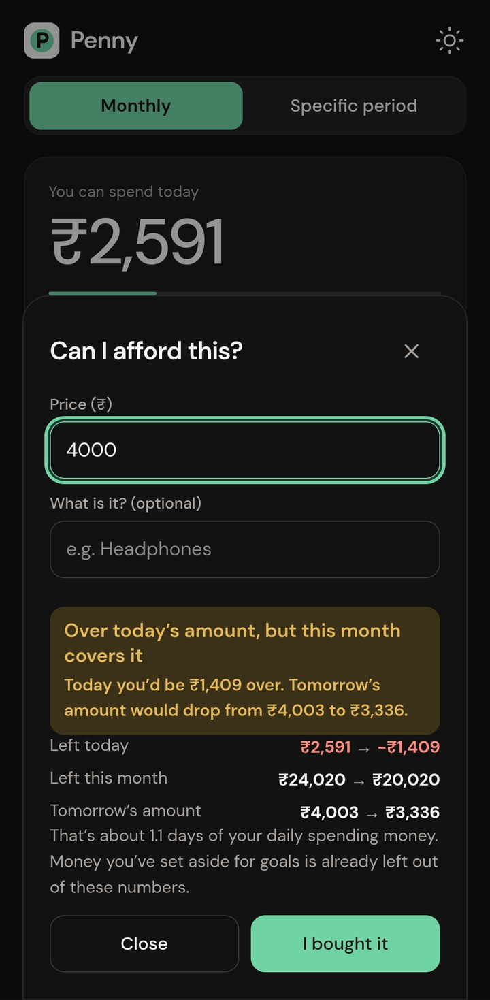
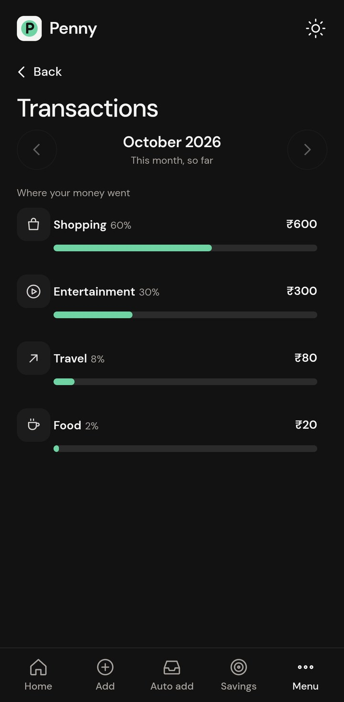
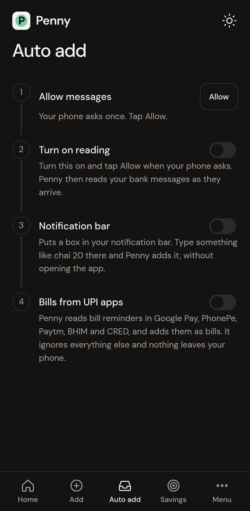
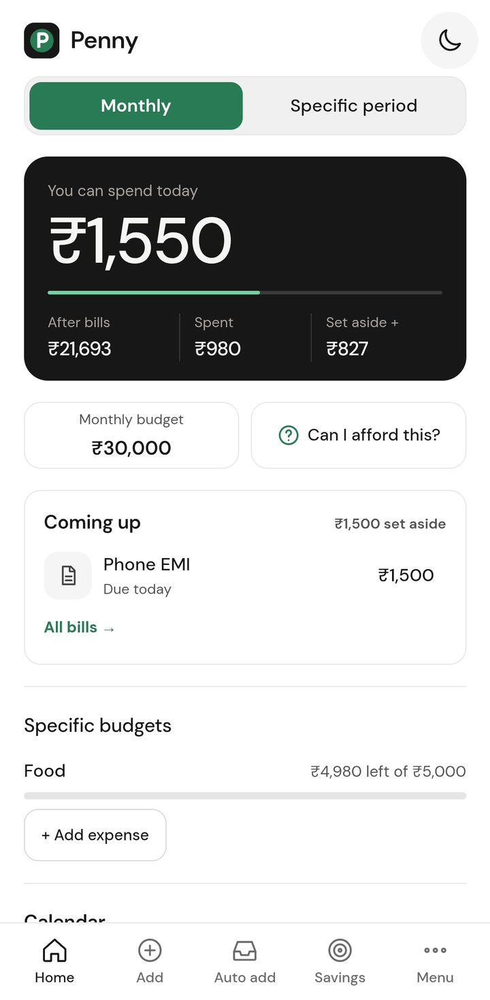
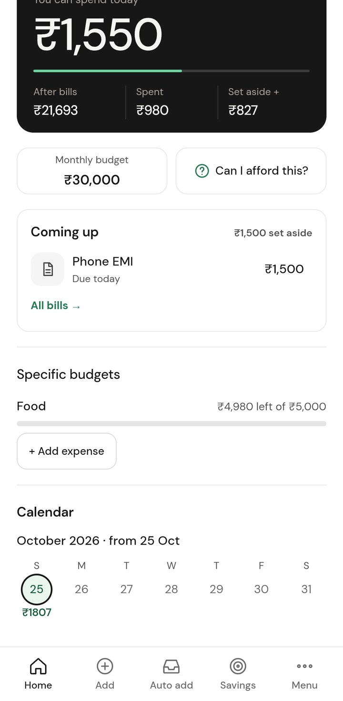
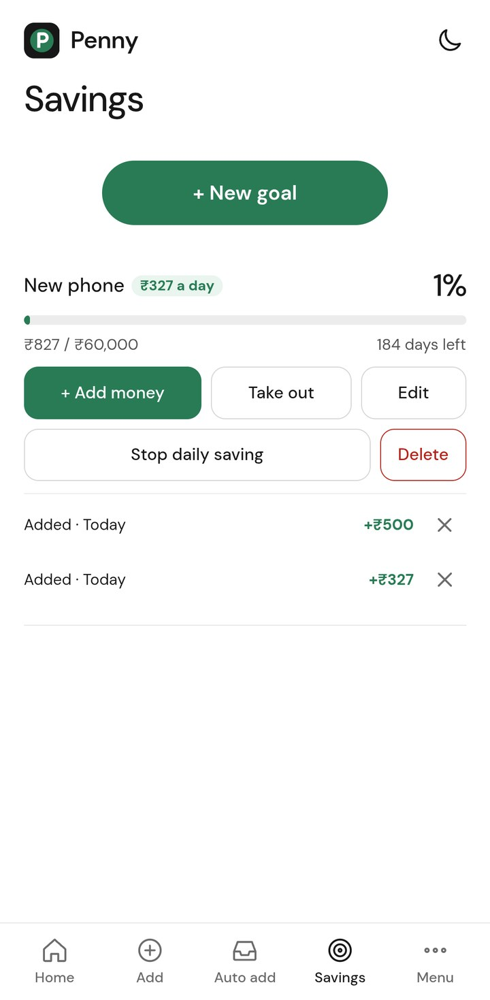

# Penny

A private expense tracker for Android that works out how much you can spend **today**.

You give Penny a monthly budget (or a budget for a trip or any other stretch of days). It sets aside your bills, your specific budgets and the money going into your goals, then spreads the rest over the days that are left. Spend less today and tomorrow's limit grows; overspend and it shrinks. Everything stays on your phone: the app has no internet permission, no account and no cloud.

<p align="center">
  
  
  
</p>

## Demo

A walkthrough of the app as a new user, with captions: setting a budget, adding expenses, goals, bills, a Specific period plan, restoring a deleted plan, backup and the themes.

<p align="center">
  <a href="docs/penny-demo.mp4"></a>
</p>

[Watch the demo video](docs/penny-demo.mp4) (about 4.5 minutes).

## What it does

**Home**
- **You can spend today.** The big card shows today's limit, what is left of the month after bills, what you have spent, and what you have set aside for goals. Tap the top of the card to edit the budget.
- **Monthly or Specific period.** Switch between a monthly budget and a plan for a set stretch of days (a trip, a festival) with its own total and daily limit.
- **Calendar.** Every day is a dot with what you spent: green when you stayed under that day's limit, red when you went over. If you set the budget part way through the month, the calendar starts from that day.
- **Specific budgets.** Keep money apart for something (Food, Shopping, Travel). Each one shows what is left, and "Add expense" takes money out of it. You choose whether a specific budget is cut from the monthly budget or kept separate on top of it.
- **Can I afford this?** Type a price and see what it does to your daily limit.
- **Add money.** Raises the monthly amount itself.

**Add**
- Type it in one line: `chai 20`, `auto 80 yesterday`, `movie 300 cash`. Penny finds the amount, the category and the day; the buttons below let you change what it guessed.
- Set money aside for a goal from the same line: `set aside 20 for phone`.

**Savings**
- Goals with a progress bar, add money, take money out, edit, delete.
- Turn on daily saving to see a plan: how long 3, 6 or 12 months would take, or type what you can save (`₹10 a day`, `₹200 a month`, `₹5,000 a year`) and Penny tells you when you will get there. Take it from your daily limit automatically, or add the money yourself.

**Menu**
- **Transactions** by category with search, and the bills that are coming up.
- **Account balances** read from your bank messages, and **Cash in hand**.
- **Bills & payday.** Repeating bills are set aside before your daily limit is worked out. The budget period can start on your payday instead of the 1st.
- **Backup & lock.** Save everything to one file and restore it later. Lock the app with your fingerprint (with a password as backup).
- **Recently deleted.** A goal, a Specific period plan or a monthly budget you delete stays here for 30 days and can be restored exactly as it was.

Also: light and dark themes, a home-screen widget, hide amounts, and a quick-add box in the notification bar.

## Screenshots

<p align="center">
  
  
  
</p>
<p align="center">
  
  
  
</p>
<p align="center">
  
  
  
</p>

And in the light theme:

<p align="center">
  
  
  
</p>

The screenshots and the video were recorded on a phone with made-up demo data.

## Automatic adding from bank messages

The full edition reads bank SMS as they arrive (the message text is parsed on the phone and never sent anywhere):

- A debit becomes an expense, with a category worked out from the shop name. Duplicates are recognised, and a payment that looks like one you typed yourself is matched instead of counted twice.
- A message saying a payment is coming (autopay, mandate) or a bill is due becomes a bill, which is set aside until you pay it.
- Balance figures in the messages keep your account balances up to date.
- Bill reminders in UPI app notifications (Google Pay, PhonePe, Paytm, BHIM, CRED) can be read too, once you give notification access. Only bill reminders are kept; payments and offers are ignored.

A bank message keeps the category it arrived with (Other, when the shop is unknown) until you change it.

## Two editions

| | Full | Lite |
|---|---|---|
| Add by typing, goals, budgets, bills, calendar, backup, lock, widget | yes | yes |
| Reads bank SMS | yes | no |
| Reads bill reminders from UPI app notifications | yes | no |
| Permissions | SMS, notifications, fingerprint | notifications, fingerprint |

On newer Android versions, Google Play Protect can block an app that asks for SMS or notification access when it is installed from a browser or a messaging app. If that happens, either turn off "Scan apps with Play Protect" in the Play Store settings while you install, or use the lite edition, which does not ask for those permissions.

## Install

Download the APK from the [Releases](../../releases) page, open it on your phone and allow installs from that source when asked.

- `Penny.apk` is the full edition.
- `Penny-lite.apk` is the lite edition.

Requires Android 7.0 or newer.

## Privacy

- There is no internet permission, so nothing can leave the phone.
- Data is stored on the device only. Android's cloud backup is switched off for the app.
- The lock hides the app in the recent-apps view and shows a black screen until you unlock.
- Backups are plain JSON files that you save and keep yourself.

## How the daily limit is worked out

1. Start with the monthly budget (or the plan's total).
2. If specific budgets are set to come out of it, take them off.
3. Take off bills that are due and not yet paid, and money you put into goals.
4. Share what remains over the days left, today included.
5. Spending above a day's limit lowers the days after it; spending less raises them.

The money logic lives in small, separate modules with unit tests, so it can be checked without a phone.

## Build it yourself

You need Node.js 18 or newer, JDK 21 and the Android SDK (Android Studio installs both).

```bash
npm install
npm test                      # unit tests for the money logic
npm run build:web             # copies the pages into www/
npx cap sync android          # copies www/ into the Android project
cd android
./gradlew assembleDebug       # full edition, debug-signed
```

The APK is written to `android/app/build/outputs/apk/debug/`.

For a signed release, create `android/keystore.properties` (it is git-ignored) with your own key:

```properties
storeFile=C:/path/to/your-release-key.jks
storePassword=...
keyAlias=...
keyPassword=...
```

then run `./gradlew assembleRelease` for the full edition, or `./gradlew assembleLite` for the lite edition. Raise `versionCode` in `android/app/build.gradle` for every release you hand out.

To try the screens in a browser without a phone:

```bash
pip install -r requirements.txt
python app.py                 # then open http://127.0.0.1:10000/today.html
```

The browser has no SMS, notifications, fingerprint or widget, so those parts are hidden there.

## Project layout

| Path | What it is |
|---|---|
| `today.html`, `today.css`, `today.js` | The app's screens and their drawing code |
| `budget-math.js`, `goals.js`, `pots.js`, `cycle.js`, `bills.js`, `trash.js` | Budget, goal, specific budget, pay-cycle, bill and recently-deleted logic |
| `sms-parser.js`, `inbox.js`, `upi.js` | Reading bank messages, bills and UPI notifications |
| `store.js`, `backup.js` | Saving to the phone, backup and restore |
| `lock.js`, `lockui.js`, `applock.js` | App lock |
| `tests*.js` | Unit tests (`node tests.js` runs them all) |
| `build-web.js` | Builds the `www/` folder the Android app shows |
| `android/` | The Android project (Capacitor), native plugins for SMS, lock, widget and notifications |
| `index.html`, `period.html`, `transactions.html`, `future-plans.html`, `other-money.html`, `app.js`, `styles.css` | The original web pages the app grew out of |
| `docs/` | Screenshots and the demo video used in this README |

The Android app id is `app.pocket.tracker`. It was the project's first name and stays so that updates install over existing copies.

## License

MIT. See [LICENSE](LICENSE).
