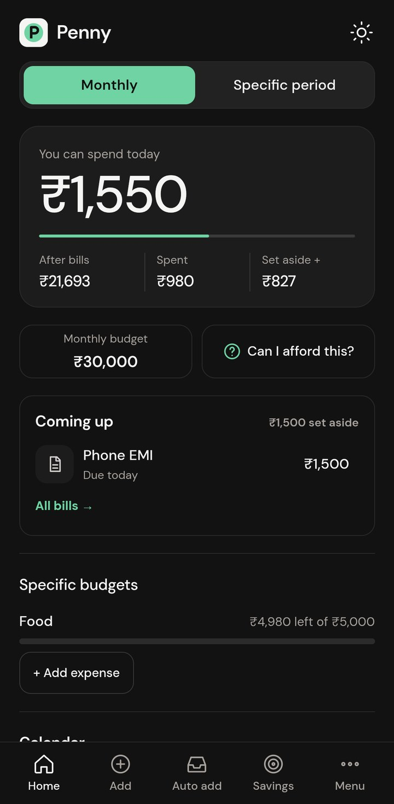
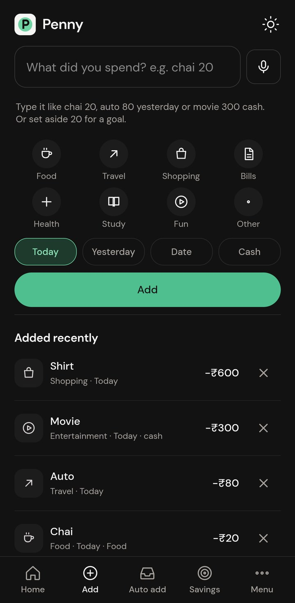
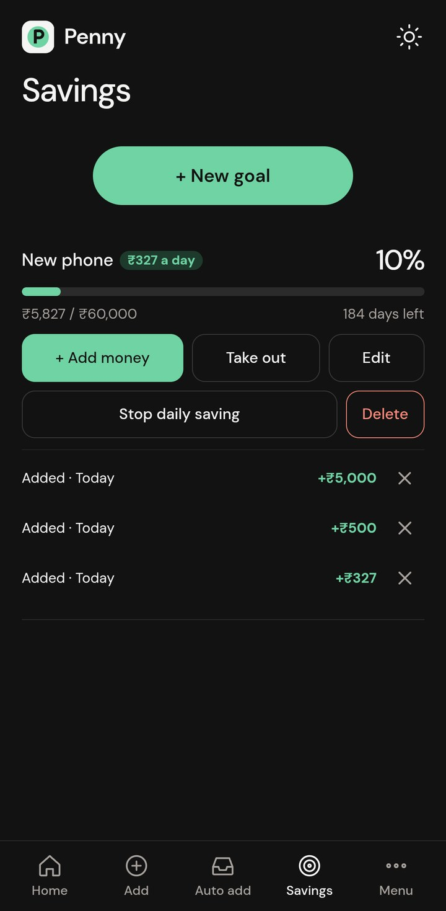
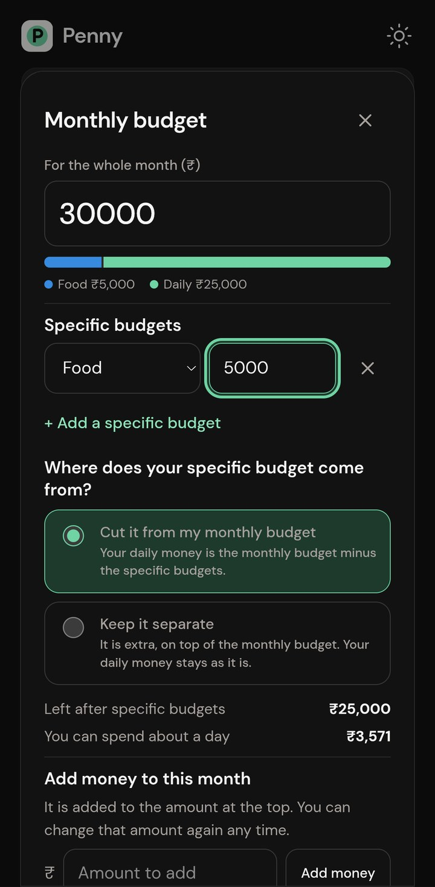
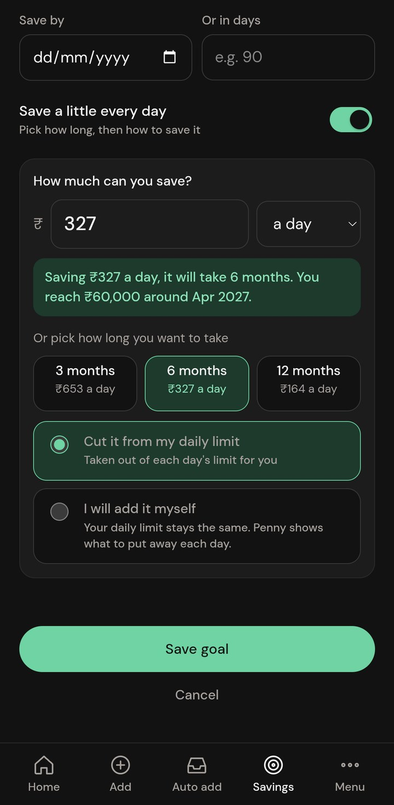
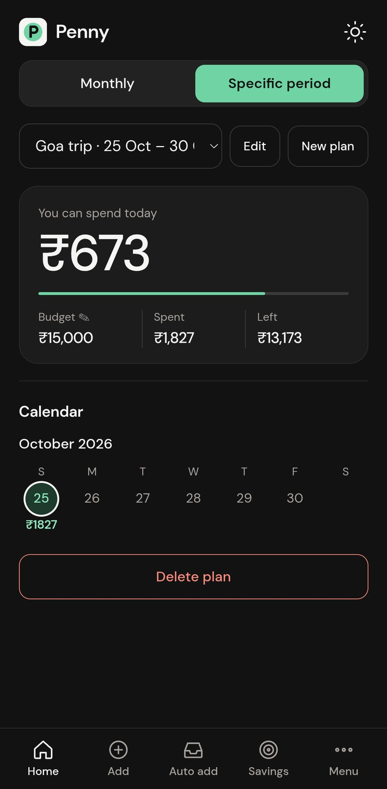
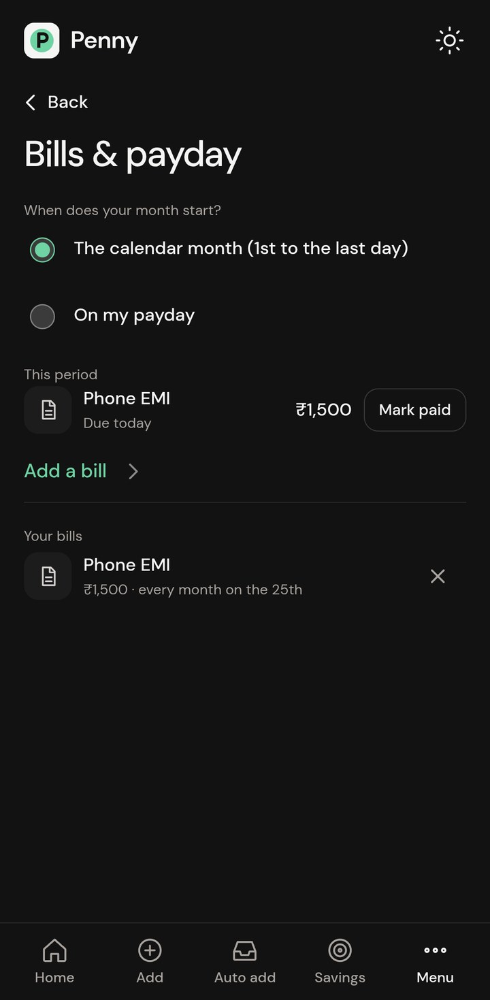
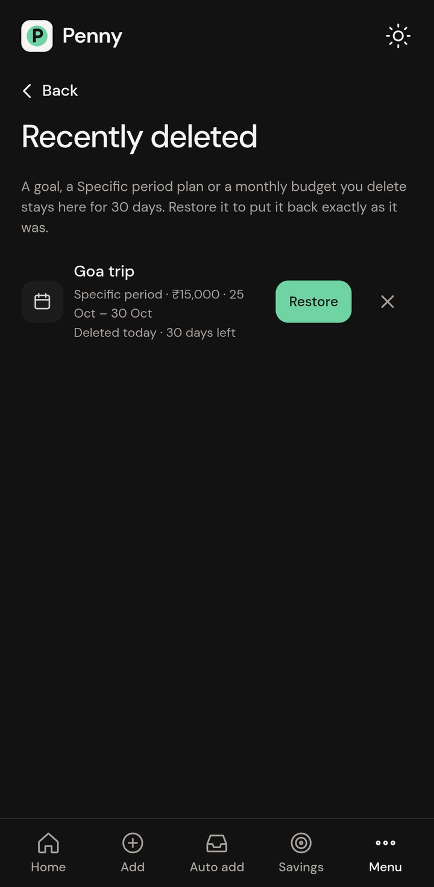
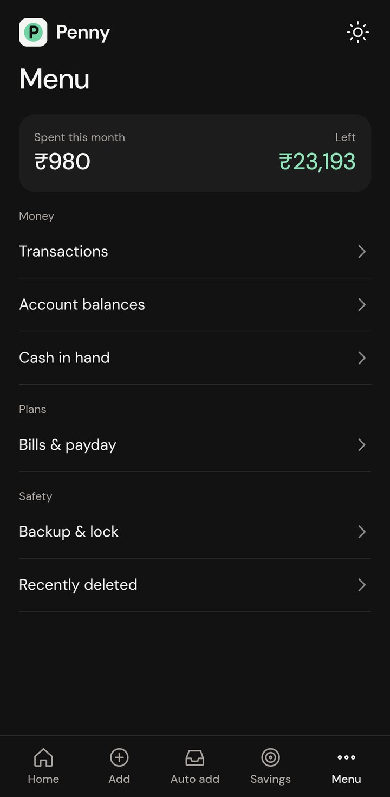

# Penny

A private expense tracker for Android that tells you how much you can spend **today**.

Give Penny a monthly budget (or a budget for a trip). It sets aside your bills and the money going into your goals, then spreads the rest over the days that are left. Spend less today and tomorrow's limit grows; overspend and it shrinks. Everything stays on your phone. There is no account, no cloud and no internet permission.

<p align="center">
  
  
  
</p>

## Demo

<p align="center">
  <a href="https://drive.google.com/file/d/1aFDZO4M_TnD5j6d6olmYL2Goqnn0eP3I/view?usp=sharing"></a>
</p>

[Watch the demo video](https://drive.google.com/file/d/1aFDZO4M_TnD5j6d6olmYL2Goqnn0eP3I/view?usp=sharing): a walkthrough of the app as a new user, about 4 minutes, with captions.

## What it does

- **Daily limit.** The home card shows what you can spend today, what is left of the month, and what you have spent.
- **Add in one line.** Type `chai 20`, `auto 80 yesterday` or `movie 300 cash`. Penny finds the amount, the category and the day.
- **Specific budgets.** Keep money apart for Food, Shopping or Travel. Choose whether it comes out of the monthly budget or stays separate.
- **Specific period.** Plan a trip or an event with its own total, daily limit and calendar.
- **Savings goals.** Set a target and a time, and Penny shows how much to put away each day. Add money from the goal or by typing `set aside 500 for phone`.
- **Bills.** Repeating bills are set aside before your daily limit is worked out.
- **Can I afford this?** Type a price and see what it does to your limit.
- **Recently deleted.** A goal, a plan or a monthly budget you delete stays here for 30 days and can be restored.
- **Backup and lock.** Save everything to one file, and lock the app with your fingerprint.
- **Light and dark themes**, account balances, cash in hand, and a home-screen widget.

<p align="center">
  
  
  
</p>
<p align="center">
  
  
  
</p>

The screenshots use made-up demo data.

## Automatic adding from bank messages

Penny can read bank SMS as they arrive. The text is read on the phone and never sent anywhere.

- A debit becomes an expense, with a category guessed from the shop name. Duplicates are recognised.
- A message about a payment that is coming up becomes a bill.
- Balances in the messages keep your account balances up to date.
- Bill reminders in UPI app notifications (Google Pay, PhonePe, Paytm, BHIM, CRED) can be read too, once you allow it.

All of this is optional and switched off until you turn it on.

## Install

Download `Penny.apk` from the [Releases](../../releases) page, open it on your phone and allow installs from that source when asked. Requires Android 7.0 or newer.

If Google Play Protect blocks the install, turn off "Scan apps with Play Protect" in the Play Store settings while you install.

## Privacy

- There is no internet permission, so nothing can leave the phone.
- Data is stored on the device only, and Android cloud backup is off.
- The lock hides the app in the recent-apps view.
- Backups are plain files that you save and keep yourself.

## How the daily limit is worked out

1. Start with the monthly budget (or the plan's total).
2. Take off specific budgets that come out of it.
3. Take off bills that are due and the money you put into goals.
4. Share what is left over the days that remain, today included.
5. Spending above a day's limit lowers the days after it, and spending less raises them.

## Build it yourself

You need Node.js 18 or newer, JDK 21 and the Android SDK.

```bash
npm install
npm test                      # unit tests for the money logic
npm run build:web             # copies the pages into www/
npx cap sync android          # copies www/ into the Android project
cd android
./gradlew assembleDebug       # APK in android/app/build/outputs/apk/debug/
```

For a signed release, create `android/keystore.properties` (git-ignored) with your own key:

```properties
storeFile=C:/path/to/your-release-key.jks
storePassword=...
keyAlias=...
keyPassword=...
```

then run `./gradlew assembleRelease`.

To try the screens in a browser without a phone:

```bash
pip install -r requirements.txt
python app.py                 # then open http://127.0.0.1:10000/today.html
```

## Project layout

| Path | What it is |
|---|---|
| `today.html`, `today.css`, `today.js` | The screens and their drawing code |
| `budget-math.js`, `goals.js`, `pots.js`, `cycle.js`, `bills.js`, `trash.js` | Budget, goal, bill and restore logic |
| `sms-parser.js`, `inbox.js`, `upi.js` | Reading bank messages and UPI bills |
| `store.js`, `backup.js`, `lock.js`, `lockui.js`, `applock.js` | Saving, backup and the app lock |
| `tests*.js` | Unit tests (`node tests.js` runs them all) |
| `android/` | The Android project (Capacitor) and its native plugins |
| `docs/` | Screenshots used in this README |

The Android app id is `app.pocket.tracker`, the project's first name, kept so updates install over existing copies.

## License

MIT. See [LICENSE](LICENSE).
